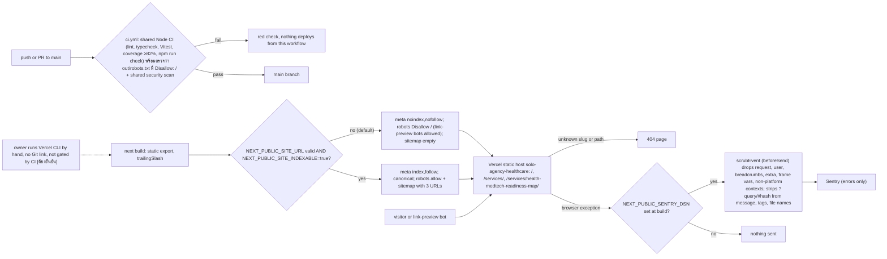
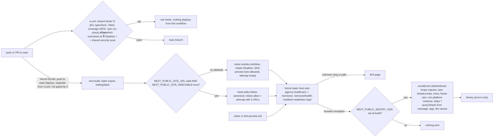

# 01 — Business process (As-Is / To-Be)

เว็บ Healthcare เป็น static showcase ภาษาไทยของ vertical นี้ (Next.js `output: 'export'`) มีหน้าแรก, `/services/` และหน้า service เดียว `/services/health-medtech-readiness-map/` ไม่มี form, API, ฐานข้อมูลหรือข้อมูลลูกค้า ผู้ชมคือผู้ซื้อที่อยากดูข้อเสนอและขอบเขตที่ยังไม่ขายจริง; owner เป็นคน build และ deploy

Last reviewed: 2026-11-28 · commit `9a90b32`

## As-Is (จากโค้ดวันนี้)

Sources: `.github/workflows/ci.yml`, `next.config.ts`, `lib/site-config.ts`, `app/robots.ts`, `app/sitemap.ts`, `app/layout.tsx`, `app/services/[slug]/page.tsx`, `lib/sentry.ts`, `instrumentation-client.ts`, `PRODUCT.md`

ข้อเท็จจริงจากโค้ดและเอกสาร:

- `ci.yml` ไม่มี deploy step; การ deploy ไป Vercel ไม่อยู่ใน repo. `PRODUCT.md` (2026-10-23) บอกว่า Vercel project ไม่มี Git link และ deploy ด้วย CLI จึงเขียนเส้นประไว้ [ต้องยืนยัน] ว่ายังเป็นจริงวันนี้
- `isIndexable` ต้องมีทั้ง public URL ที่ผ่านการตรวจ (http/https, ไม่มี query/fragment/credentials) และ `NEXT_PUBLIC_SITE_INDEXABLE=true`; ไม่ครบจะเป็น noindex เสมอ
- ค่า `NEXT_PUBLIC_SITE_URL` / `NEXT_PUBLIC_SITE_INDEXABLE` บน Vercel production ไม่อยู่ใน repo [ต้องยืนยัน]; `PRODUCT.md` บอกว่ายังไม่ตั้ง
- `scrubEvent` (`lib/sentry.ts`) ตัด request, user, breadcrumbs, extra, vars ใน stack frame และ context ที่ไม่ใช่ platform; ตัด ?query/#hash ออกจาก message, tag, ชื่อไฟล์ (ไม่ได้ตัดข้อความ error ส่วนอื่น); ไม่ส่ง trace/replay
- Sentry ปิดเมื่อไม่มี DSN; `PRODUCT.md` บอกว่าตั้ง DSN บน Vercel แล้วและมีผลเมื่อ deploy ครั้งถัดไป [ต้องยืนยัน]

## To-Be (PRODUCT.md §Live URL and deploy state)

เฉพาะสิ่งที่เขียนไว้: เมื่อ owner เชื่อม Vercel Git (owner action D9) การ push เข้า `main` จะ deploy ผ่าน Vercel Git โดยไม่ต้องรัน CLI (เป็นอีกเส้นทางหนึ่งแยกจาก `ci.yml` ไม่ถูก CI gate)

Sources: `PRODUCT.md` §Live URL and deploy state, `docs/UPGRADE-PLAN.md` (P1, P2)

## Gap

| ID | As-Is → To-Be | Status | Owner | Evidence |
|---|---|---|---|---|
| G1 | project `solo-agency-healthcare` ไม่มี Vercel Git link, owner deploy ด้วย Vercel CLI (ตาม PRODUCT.md วันที่ 2026-10-23) → เชื่อม Vercel Git ให้ push เข้า `main` deploy | decide | owner | `PRODUCT.md` §Live URL and deploy state (owner action D9); สถานะวันนี้ [ต้องยืนยัน] |
| G2 | indexing ปิด (`noindex`, `Disallow: /`) เพราะยังไม่ยืนยัน public URL → ตั้ง `NEXT_PUBLIC_SITE_URL` / `NEXT_PUBLIC_SITE_INDEXABLE=true` บน Vercel ด้วย URL ที่อนุมัติ | decide | owner | `docs/UPGRADE-PLAN.md` P1 |
| G3 | service page เดียว → เพิ่ม service page ที่สองเมื่อมี offer ที่อนุมัติแล้ว | decide | owner | `docs/UPGRADE-PLAN.md` P2; `lib/pseo.ts` รองรับ service เดียว |

## Open questions

- Vercel project `solo-agency-healthcare` ยังไม่มี Git link อยู่จริงหรือไม่ และ production build ตั้ง `NEXT_PUBLIC_SITE_URL` / `NEXT_PUBLIC_SITE_INDEXABLE` ไว้หรือไม่ (ดูจาก Vercel เท่านั้น)
